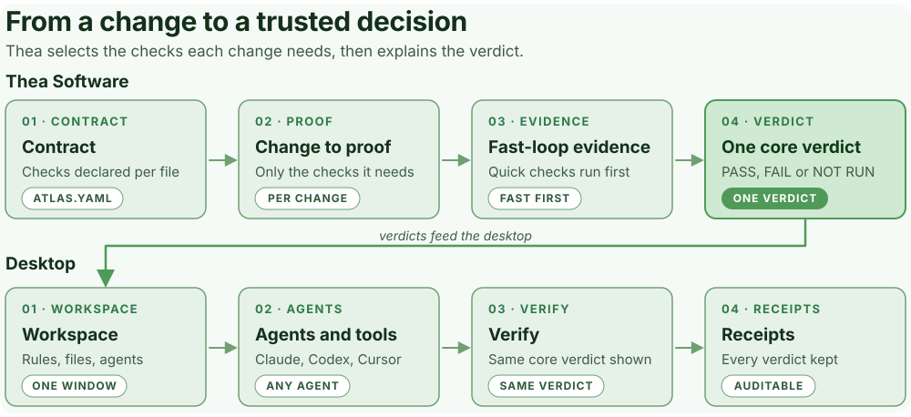

<!-- AGENTS: do not read this page breadth-first. Plug in: `python scripts/atlas.py port <file>`,
     or parse .agent/bootstrap.json — one record back. -->
<!-- mcp-name: io.github.HLIntel/thea -->
<div align="center">
  <h1>Thea Software</h1>
  
  
</div>

<table align="center">
  <tr>
    <td align="center" width="720">

### TheaOS Desktop

TheaOS Desktop is the native workspace: rules, agents, verification and receipts in one window.

<a href="#thea-desktop-preview"></a>

</td>
  </tr>
</table>

<p align="center">
  <a href="https://github.com/HLIntel/thea-software/actions/workflows/atlas-ci.yml"></a>
  <a href="https://github.com/HLIntel/thea-software/releases/latest"></a>
  <a href="https://scorecard.dev/viewer/?uri=github.com/HLIntel/thea-software"></a>
  <a href="https://pypi.org/project/thea-software/"></a>
  <a href="https://pypi.org/project/thea-software/"></a>
  <a href="LICENSE"></a>
</p>

<!-- BEGIN generated: headline (python scripts/atlas.py index --write) -->

**Protocol:** a change maps to proof; Thea selects evidence and the build enforces the verdict ([evidence](#what-it-measurably-buys)). Agents: [llms.txt](llms.txt); chats: [CHAT.md](CHAT.md).

<!-- END generated: headline -->

**Start:** [install/use](#quickstart) · [TheaOS preview](#thea-desktop-preview) · [agents](llms.txt) · [chat](CHAT.md) · [adapters](models/README.md)

## Why this exists

An agent can report a change as done without running a single check. A check that never ran looks
the same as a check that passed, and the change ships. Thea closes that gap:

- **Every change maps to proof.** [`atlas.yaml`](atlas.yaml) lists the checks each kind of file owes,
  and the gate runs them before the change is called finished.
- **Refusal happens at commit, for any agent.** A git hook runs the same check-only command whether
  Claude, Codex, Cursor or a person made the commit.
- **A skipped check is never a pass.** A missing tool is reported as `SKIP`, counted, and kept out
  of the pass count. Gates report `PASS`, `FAIL` or `NOT RUN`; missing tools never go green.

<!-- BEGIN generated: proof-flow (python scripts/atlas.py index --write) -->

<p align="center">
  
</p>

<!-- END generated: proof-flow -->

<!-- BEGIN generated: gate-example (python scripts/atlas.py index --write) -->

```console
$ thea gate scripts/doctor.py
1. formatter: ruff format --check scripts/doctor.py
2. compiler_or_typechecker: python3 -c 'import ast,sys; [ast.parse(open(f, encoding="utf-8").read(), f) for f in sys.argv[1:]]' scripts/doctor.py
3. unit_tests: pytest
```

<!-- END generated: gate-example -->

## Quickstart

<!-- BEGIN generated: install (python scripts/atlas.py index --write) -->

```bash
# no checkout
uv tool install thea-software && thea doctor
# or, editable
git clone --depth 1 --branch v3.60.0 https://github.com/HLIntel/thea-software ~/thea && uv tool install --editable ~/thea && thea doctor
```

<!-- END generated: install -->

In your repository:

```bash
cd path/to/your-repo && thea init   # checks, Claude Code + Codex wiring, first run
thea verify && thea report          # after a change: verdicts, then what is unverified
```

With an impact map, `thea verify --changed` runs planted groups with moved dependencies or no record.
It speeds feedback; `thea verify` remains the final verdict.

Agents reach Thea over MCP: `thea-mcp` is read-only today. Planned for Thea Desktop: a gate that
inspects, logs and approves each tool call before an external agent changes local files or databases.
Not built yet. No-shell chat: [CHAT.md](CHAT.md). Add Thea to another repository:
[CONSUMING](docs/CONSUMING.md).

## Where it fits

- **Any agent.** One contract for Claude Code, Codex, Cursor, opencode and Hermes. The adapters are in
  [models/README.md](models/README.md); the commit gate does not depend on which one is running.
- **Any repository.** `thea init` wires a repository in one step. Consumers add the reusable CI
  workflow from [CONSUMING](docs/CONSUMING.md) so the verdict on a laptop and in CI is the same command.
- **Any language we route.** Each language × check pair is either answered by a command or declared
  as having no tool, so an unanswered pair cannot hide.

## Thea Desktop preview

TheaOS Desktop is the native workspace over the same core: the workspace, agent controls,
verification and history in one window. The CLI is ready now. Desktop is available by
[preview request](https://github.com/HLIntel/thea-software/issues/new?title=Thea%20Desktop%20preview%20request)
— no secrets or private code. A public Desktop installer is not published yet.
[Limits](docs/CONSUMING.md#optional-hlintel-services).

<!-- BEGIN generated: port-example (python scripts/atlas.py index --write) -->

```console
$ thea port scripts/doctor.py --line
◉ scripts/doctor.py │ ⠟backend │ python │ ⌂scripts │ ✓3 │ ⚠1 │ → thea gate scripts/doctor.py
$ thea port scripts --line
◎ scripts │ ⠟143 │ ⌂scripts │ → thea brainstorm
$ thea port . --line
○ . │ ⠟171 ⠁4 ⠿4 │ → thea check
```

<!-- END generated: port-example -->

## What it measurably buys

What the recorded instruments have caught in real runs. They prove routing and refusals, not end-to-end task success
([limits](docs/CERTIFICATION.md#what-the-numbers-do-not-prove)).

<!-- BEGIN generated: measured-benefits (python scripts/atlas.py index --write) -->

**Failures caught**

- **31/31** planted breaks refused at commit, across 20 of 40 languages. 20 more have an example its toolchain has not run; 0 have none yet (`enforce.py` v3.60.0).
- **133** mistake kinds planted in the tests, each refused.
- **118** failure shapes recorded from real runs: 205 sightings, 47 recurred, 97 now guarded, 21 host-only (3 of them recurred).
- **1076** refusals in daily use (37 shapes, 654 re-fired). Verify: 39 passed and 187 failed, of 485 runs. 112 of 115 lands armed; 701 lessons shown (`agents.py --field` v3.59.0).
- **24/24** solo commits clean with or without the hook; a planted broken commit is refused.
- **6** agent controls block, never warn: narrow_tools, sandbox, budget, approval, effects, audit.

**Cost**

- **1,717** tokens read before routing; 188 more documents (618 KiB) load only when a route names one.
- **89%** fewer tokens than pasting every tool list; 50% fewer than blind.
- **10 KiB** install: 1 module, 2 dependency — 8 in total with its own dependencies.

**Coverage**

- **360** language × check pairs (40 × 9), all answered: 144 by a command, 216 by a declared _no tool_, 0 silent.

<!-- END generated: measured-benefits -->

## Agent contract

- **Route:** `thea port <file>`, or parse [.agent/bootstrap.json](.agent/bootstrap.json); load only its names.
- **Automate:** add `--json`; records follow [the output schema](tools/atlas-output.schema.json).
- **Before shell:** `thea shell --json "<cmd>"`; exit 3 means its verdict would be misread.
- **Land:** `python scripts/branchstate.py --land`; check `thea landed <branch>` before deletion.
- **Judge and report:** use the [judgment rungs](docs/systems/AGENT-HARNESS.md#judgment-rungs); file breaks with the [`thea` skill](skills/thea/SKILL.md).

## Counts, computed

Generated on every build; `check` refuses drift. Machine-readable: [.agent/facts.json](.agent/facts.json).

<!-- BEGIN generated: repository-facts (python scripts/atlas.py index --write) -->

- **388** tool entries — across 40 manifests and 5 kinds, validated against `tools/tools.schema.json`
- **347** agreement edges — each a file tied to the declaration it answers for
- **92** instruments — each stating what it proves, what it does not, and what closes the gap
- **7** change classes — and 13 task profiles, in `atlas.yaml`
- **141** harness Python files — every one held by `lint` · `format` · `typecheck`
- **3.60.0** contract version — `VERSION`, asserted in 8 other files

<!-- END generated: repository-facts -->

## Find your way

- **Every document:** [docs index](docs/INDEX.md) · [wiki](docs/wiki/README.md)
- **Languages:** [atlas](languages/ATLAS.md) · [routing](docs/wiki/CODE-ROUTING.md) · [verification](docs/VERIFY.md)
- **Agents:** [harness](docs/systems/AGENT-HARNESS.md) · [`.thea`](docs/THEA-LANGUAGE.md) · [runtimes](models/README.md)
- **Why a rule:** `thea why` · `thea failures` · [instruments](docs/INSTRUMENTS.md)
- **Security:** [policy](SECURITY.md) · [OpenSSF](docs/OPENSSF.md) · [contributing](CONTRIBUTING.md)

## Project

Version tracks the **contract**, not content ([versioning](docs/VERSIONING.md)).
Built by **HLIntel LLC**, public on purpose ([about](ABOUT.md)). Contributions pass `thea verify`. [MIT License](LICENSE).

Updated: contract v3.60.0
